  
    
    
    
  <a href="#easy">Easy</a> · <a href="#medium">Medium</a> · <a href="#hard">Hard</a> · <a href="https://leetcode.com/u/paranthamank/">LeetCode profile</a>

## Progress

  

## Solutions

### Easy · 16 problems

| # | Problem | Time · Space | Runtime | Memory | Code |
|---:|---|---|---|---|---|
| 1 | [Two Sum](https://leetcode.com/problems/two-sum/) brute force · nested loops | `O(n²)` · `O(1)` | 33 ms 44.58% | 47.2 MB 41.16% | [`C`](0001-two-sum/solution.c) [`Java`](0001-two-sum/solution.java) |
| 9 | [Palindrome Number](https://leetcode.com/problems/palindrome-number/) reverse number · compare original | `O(log x)` · `O(1)` | 0 ms 100.00% | 8.8 MB 62.57% | [`C`](0009-palindrome-number/solution.c) |
| 20 | [Valid Parentheses](https://leetcode.com/problems/valid-parentheses/) stack · match brackets | `O(n)` · `O(n)` | 0 ms 100.00% | 8.7 MB 67.84% | [`C`](0020-valid-parentheses/solution.c) |
| 21 | [Merge Two Sorted Lists](https://leetcode.com/problems/merge-two-sorted-lists/) copy nodes into new list | `O(m+n)` · `O(m+n)` | 0 ms 100.00% | 11.6 MB 8.90% | [`C`](0021-merge-two-sorted-lists/solution.c) |
| 27 | [Remove Element](https://leetcode.com/problems/remove-element/) shift left on match · in place | `O(n²)` · `O(1)` | 0 ms 100.00% | 43.4 MB 61.13% | [`Java`](0027-remove-element/solution.java) |
| 58 | [Length of Last Word](https://leetcode.com/problems/length-of-last-word/) scan for last word start | `O(n)` · `O(1)` | 0 ms 100.00% | 8.9 MB 16.33% | [`C`](0058-length-of-last-word/solution.c) |
| 66 | [Plus One](https://leetcode.com/problems/plus-one/) handle carry · copy array | `O(n)` · `O(n)` | 0 ms 100.00% | 10 MB 67.92% | [`C`](0066-plus-one/solution.c) |
| 125 | [Valid Palindrome](https://leetcode.com/problems/valid-palindrome/) filter alnum · two pointer compare | `O(n)` · `O(n)` | 0 ms 100.00% | 9.3 MB 21.39% | [`C`](0125-valid-palindrome/solution.c) |
| 136 | [Single Number](https://leetcode.com/problems/single-number/) brute force · nested loops | `O(n²)` · `O(1)` | 731 ms 11.74% | 10.2 MB 33.58% | [`C`](0136-single-number/solution.c) |
| 206 | [Reverse Linked List](https://leetcode.com/problems/reverse-linked-list/) | — | 0 ms 100.00% | 13.6 MB 11.72% | [`C++`](0206-reverse-linked-list/solution.cpp) |
| 344 | [Reverse String](https://leetcode.com/problems/reverse-string/) | — | 0 ms 100.00% | 17.8 MB 30.69% | [`C`](0344-reverse-string/solution.c) |
| 415 | [Add Strings](https://leetcode.com/problems/add-strings/) | — | 0 ms 100.00% | 9 MB 92.82% | [`C++`](0415-add-strings/solution.cpp) |
| 485 | [Max Consecutive Ones](https://leetcode.com/problems/max-consecutive-ones/) single pass · count streak | `O(n)` · `O(1)` | 0 ms 100.00% | 13.1 MB 90.02% | [`C`](0485-max-consecutive-ones/solution.c) |
| 1580 | [Shuffle the Array](https://leetcode.com/problems/shuffle-the-array/) interleave two halves in order | `O(n)` · `O(n)` | 12 ms 72.80% | 12.2 MB 92.26% | [`C`](1580-shuffle-the-array/solution.c) |
| 1894 | [Merge Strings Alternately](https://leetcode.com/problems/merge-strings-alternately/) alternate chars · append remainder | `O(n+m)` · `O(n+m)` | 0 ms 100.00% | 8.8 MB 40.76% | [`C`](1894-merge-strings-alternately/solution.c) |
| 2058 | [Concatenation of Array](https://leetcode.com/problems/concatenation-of-array/) duplicate array via modulo | `O(n)` · `O(n)` | 0 ms 100.00% | 15.1 MB 27.39% | [`C`](2058-concatenation-of-array/solution.c) |

### Medium · 8 problems

| # | Problem | Time · Space | Runtime | Memory | Code |
|---:|---|---|---|---|---|
| 2 | [Add Two Numbers](https://leetcode.com/problems/add-two-numbers/) iterative digit addition · new list | `O(n)` · `O(n)` | 0 ms 100.00% | 13.3 MB 83.88% | [`C`](0002-add-two-numbers/solution.c) |
| 3 | [Longest Substring Without Repeating Characters](https://leetcode.com/problems/longest-substring-without-repeating-characters/) sliding start · inner duplicate scan | `O(n²)` · `O(1)` | 22 ms 14.46% | 9.5 MB 99.49% | [`C`](0003-longest-substring-without-repeating-characters/solution.c) |
| 7 | [Reverse Integer](https://leetcode.com/problems/reverse-integer/) extract digits · check overflow | `O(log x)` · `O(1)` | 0 ms 100.00% | 9.3 MB 49.14% | [`C`](0007-reverse-integer/solution.c) |
| 19 | [Remove Nth Node From End of List](https://leetcode.com/problems/remove-nth-node-from-end-of-list/) two pass · count then delete | `O(n)` · `O(1)` | 0 ms 100.00% | 10.2 MB 81.60% | [`C`](0019-remove-nth-node-from-end-of-list/solution.c) |
| 29 | [Divide Two Integers](https://leetcode.com/problems/divide-two-integers/) | — | 2107 ms 5.00% | 8.6 MB 36.27% | [`C++`](0029-divide-two-integers/solution.cpp) |
| 50 | [Pow(x, n)](https://leetcode.com/problems/powx-n/) | — | 0 ms 100.00% | 8.8 MB 8.57% | [`C++`](0050-powx-n/solution.cpp) |
| 61 | [Rotate List](https://leetcode.com/problems/rotate-list/) repeatedly move tail to head | `O(k*n)` · `O(1)` | 0 ms 100.00% | 11.5 MB 33.45% | [`C`](0061-rotate-list/solution.c) |
| 189 | [Rotate Array](https://leetcode.com/problems/rotate-array/) buffer tail · shift · restore | `O(n)` · `O(k)` | 0 ms 100.00% | 27.4 MB 76.77% | [`C`](0189-rotate-array/solution.c) |

### Hard · 1 problem

| # | Problem | Time · Space | Runtime | Memory | Code |
|---:|---|---|---|---|---|
| 4 | [Median of Two Sorted Arrays](https://leetcode.com/problems/median-of-two-sorted-arrays/) merge sorted arrays · pick middle | `O(m+n)` · `O(m+n)` | 0 ms 100.00% | 11.9 MB 87.29% | [`C`](0004-median-of-two-sorted-arrays/solution.c) |

---

   

